<div align="center">

# LPU UMS Agent → Autonomous Browser Agent & Academic Copilot 🎓✨

**An autonomous, privacy-first Browser Agent with Computer Use for Attendance Intelligence, Examination Date Sheets, Seating Plans, Timetable Navigation, and Voice Interaction on LPU UMS.**

[](http://lpuumsagent.vercel.app/)
[](https://drive.google.com/file/d/1u1zKyuFMx4wedX4Z2BqrnG-K5Os7hGu8/view?usp=sharing)
[](https://github.com/MohammadFayasKhan/LpuUmsAgent)
[](https://developer.chrome.com/docs/extensions/mv3/)
[](https://reactjs.org/)
[](https://www.typescriptlang.org/)
[](https://developer.apple.com/design/human-interface-guidelines/)
[](https://fastapi.tiangolo.com/)
[](https://vitest.dev/)
[](https://pytest.org/)
[](LICENSE)

<br/>


<p align="center">
  <a href="http://lpuumsagent.vercel.app/"><b>🌐 Live Website: http://lpuumsagent.vercel.app/</b></a> &nbsp;•&nbsp;
  <a href="https://drive.google.com/file/d/1u1zKyuFMx4wedX4Z2BqrnG-K5Os7hGu8/view?usp=sharing"><b>📦 Download Extension (.ZIP)</b></a>
</p>

<p align="center"><em>Native Chrome Side Panel Agent operating directly inside the student's authenticated LPU UMS session</em></p>

</div>

> **🌐 Live Showcase Website:** [http://lpuumsagent.vercel.app/](http://lpuumsagent.vercel.app/)  
> **📦 Direct Extension Download:** [Google Drive Mirror (.ZIP)](https://drive.google.com/file/d/1u1zKyuFMx4wedX4Z2BqrnG-K5Os7hGu8/view?usp=sharing)  
> **⚡ Version:** v2.4.0 (Manifest V3 · Chrome Side Panel · Ready to Install)  
> **No passwords. No scrapers. No headless browsers.**  
> LPU UMS Agent works inside your real Chrome session → sees the same pages you see → navigates with a visible AI cursor → extracts verified data → stores everything locally on your device.

---

## 🏛️ Platform Specifications & Architecture Matrix

| Specification Parameter | Platform Standard |
| :--- | :--- |
| **Project Title** | **LPU UMS Agent - Autonomous Browser Agent & Academic Copilot** |
| **Live Showcase Website** | **[http://lpuumsagent.vercel.app/](http://lpuumsagent.vercel.app/)** |
| **Download Package** | **[Google Drive (.ZIP Release)](https://drive.google.com/file/d/1u1zKyuFMx4wedX4Z2BqrnG-K5Os7hGu8/view?usp=sharing)** |
| **Target Portals** | **`ums.lpu.in` (Legacy ASP.NET/SSRS) & `studentums.lpu.in` (Angular SPA)** |
| **Runtime Environment** | **Google Chrome Side Panel (Manifest V3 Extension)** |
| **Execution Paradigm** | **Autonomous In-Session Computer Use (Perception-Action Loop)** |
| **Credential Security** | **Zero Password Storage & Zero Cookie Interception (Uses live authenticated session)** |
| **Perception & Grounding** | **Hybrid 2D IoU Spatial Matching + Semantic Text Grounding + MutationObserver SPA Watchers** |
| **Cursor Physics** | **Smooth Cubic-Bézier Natural Trajectories with Cosine Smoothstep Easing (60 FPS)** |
| **Voice & Speech Engine** | **Dual-Tier Groq Pipeline: Whisper Large-v3 STT + Orpheus Expressive Audio TTS** |
| **Voice Interactivity** | **Full Speech Interruption / Barge-in Detection & Dynamic Milestone Narration** |
| **Attendance Computation** | **100% Deterministic Algebra (Zero LLM math hallucinations for safe bunks/recovery)** |
| **Storage Architecture** | **Local-First IndexedDB v3 (Persistent on-device memory with privacy controls)** |
| **UI Design System** | **Apple iOS Human Interface Guidelines (Frosted Acrylic, Specular Rims, Spring Motion)** |
| **Automated Tests** | **422 Extension Tests (Vitest) + 22 Backend Tests (Pytest) + Playwright E2E** |

---

## 🔬 In-Field Diagnostics & Results Demonstration

<div align="center">
  <h3>Portal Mounting & Multimodal Live Voice Subsystem</h3>
  <table border="0" width="100%" cellspacing="12" cellpadding="0">
    <tr>
      <td width="50%" align="center" valign="top">
        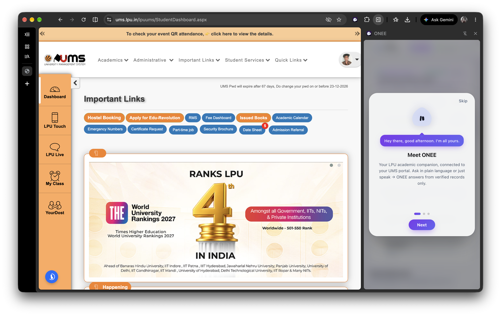
        <br/><br/>
        <em><b>Figure 1: Native Side Panel Mounting & Portal Awareness</b><br/>ONEE operates seamlessly inside the student's live authenticated session on <code>ums.lpu.in</code>, mounting alongside the portal with zero password prompts or headless browser risks.</em>
      </td>
      <td width="50%" align="center" valign="top">
        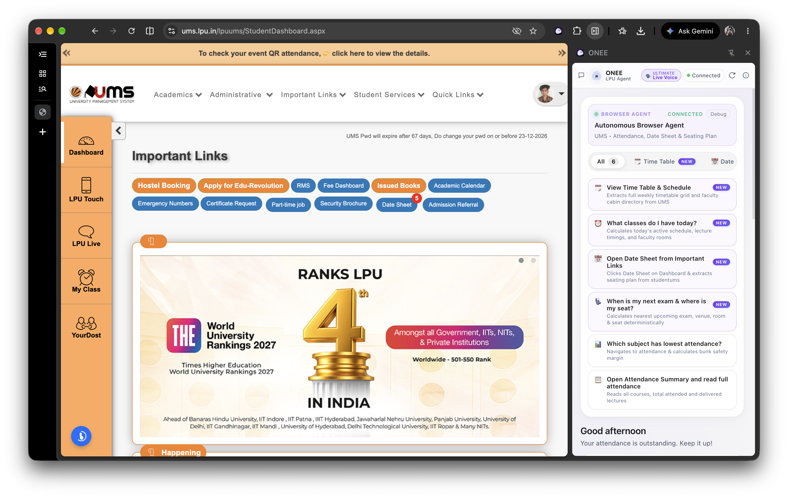
        <br/><br/>
        <em><b>Figure 2: ONEE ULTIMATE Live Voice Subsystem</b><br/>Full-duplex voice execution pipeline powered by Groq Whisper STT and Groq Orpheus TTS, with hardware audio prewarming, speech barge-in, and semantic progress narration.</em>
      </td>
    </tr>
  </table>
</div>

<br/>

<div align="center">
  <h3>Deterministic Attendance Algebra & Interactive Bunk Calculator</h3>
  <table border="0" width="100%" cellspacing="12" cellpadding="0">
    <tr>
      <td width="50%" align="center" valign="top">
        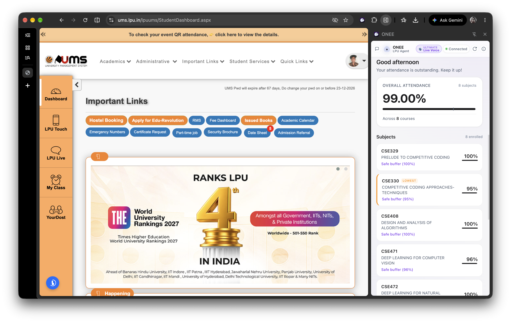
        <br/><br/>
        <em><b>Figure 3: Deterministic Attendance Extraction & Grounding</b><br/>Live extraction of enrolled courses, attended/delivered lectures, duty leave reconciliation, and verified overall percentage with zero LLM math errors.</em>
      </td>
      <td width="50%" align="center" valign="top">
        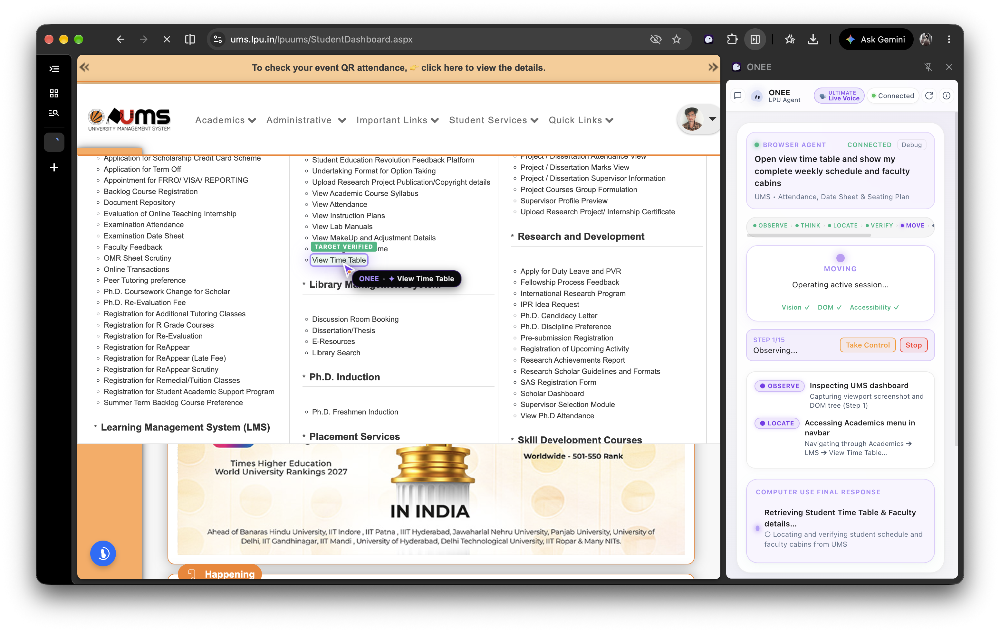
        <br/><br/>
        <em><b>Figure 4: Interactive Safe-Bunk Calculator & Margin Analysis</b><br/>Exact algebraic bounds calculating allowable bunks and required recovery classes across 75%, 80%, and 85% thresholds with discrepancy detection.</em>
      </td>
    </tr>
  </table>
</div>

<br/>

<div align="center">
  <h3>Timetable Traversal & Context-Aware Procedural Mascot</h3>
  <table border="0" width="100%" cellspacing="12" cellpadding="0">
    <tr>
      <td width="50%" align="center" valign="top">
        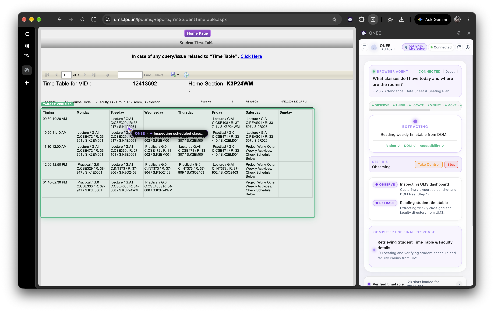
        <br/><br/>
        <em><b>Figure 5: SSRS ReportViewer Timetable Container Navigation</b><br/>Deep DOM traversal through <code>Reports/frmStudentTimeTable.aspx</code>, internal container scrolling down to faculty directories without scrolling the student's page, and Apple-style day filtering.</em>
      </td>
      <td width="50%" align="center" valign="top">
        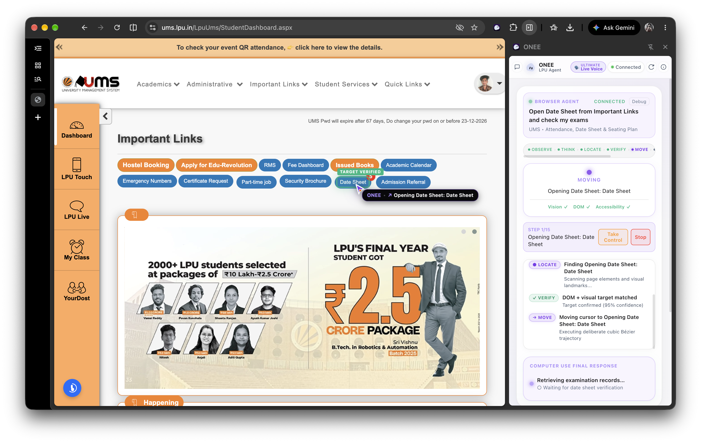
        <br/><br/>
        <em><b>Figure 6: Context-Aware Procedural 3D Companion Mascot</b><br/>22 dynamic state-driven SVG expressions synchronized with real-time agent lifecycle events (<code>THINKING</code>, <code>LOCATING</code>, <code>MOVING</code>, <code>VERIFIED</code>) via <code>oneeBridge</code>.</em>
      </td>
    </tr>
  </table>
</div>

<br/>

<div align="center">
  <h3>Autonomous Seating Plan Navigation & Examination Schedule Verification</h3>
  <table border="0" width="100%" cellspacing="12" cellpadding="0">
    <tr>
      <td width="50%" align="center" valign="top">
        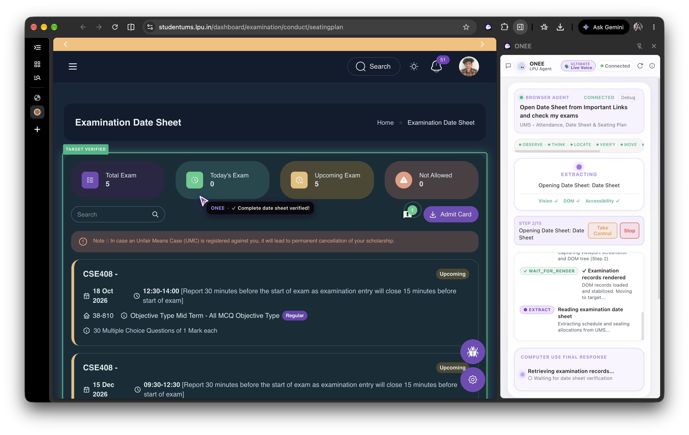
        <br/><br/>
        <em><b>Figure 7: Autonomous Browser Agent on Seating Plan Portal</b><br/>Visible AI cursor moving along smooth cubic-Bézier trajectories on <code>studentums.lpu.in</code> with Angular SPA dynamic loading detection (<code>WAIT_FOR_RENDER</code>).</em>
      </td>
      <td width="50%" align="center" valign="top">
        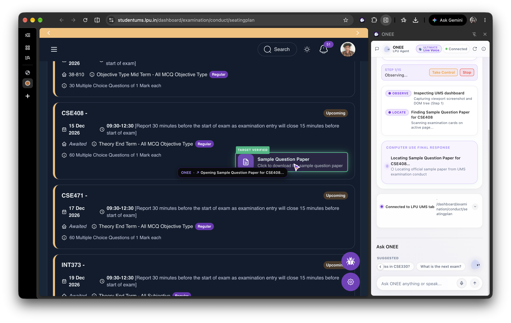
        <br/><br/>
        <em><b>Figure 8: Verified Examination Date Sheet & Venue Extraction</b><br/>Chronological examination schedule extraction with relative reporting windows (<code>Report 30 mins before</code>), shift timings, room designations, and desk allocations.</em>
      </td>
    </tr>
  </table>
</div>

<br/>

<div align="center">
  <h3>Multi-Course Date Sheet Indexing & Sample Question Paper Sub-Agent</h3>
  <table border="0" width="100%" cellspacing="12" cellpadding="0">
    <tr>
      <td width="50%" align="center" valign="top">
        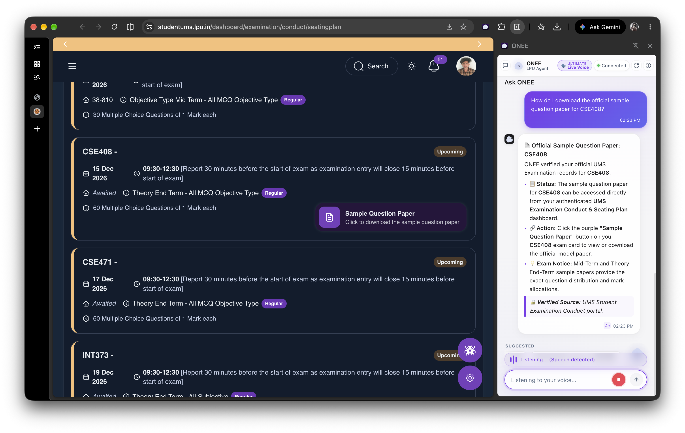
        <br/><br/>
        <em><b>Figure 9: Multi-Course Schedule Cards & Desk Assignments</b><br/>Comprehensive examination schedule indexing across multiple subjects with room numbers, block designations, desk allocations, and next-exam spotlighting.</em>
      </td>
      <td width="50%" align="center" valign="top">
        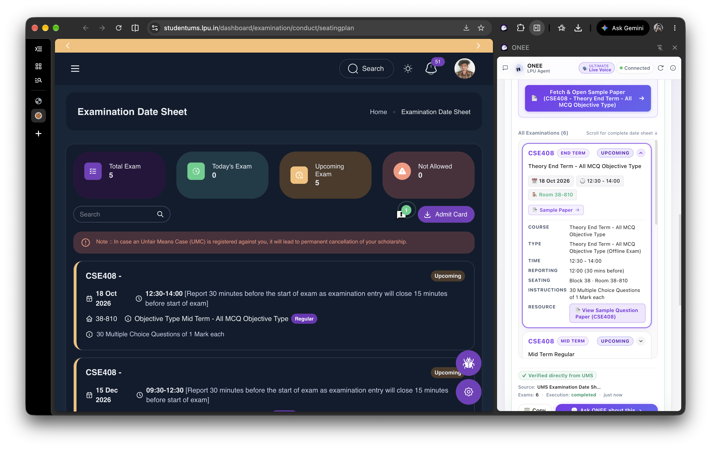
        <br/><br/>
        <em><b>Figure 10: Sample Paper Sub-Automation (SamplePaperAgent)</b><br/>Targeted retrieval and instant previewing of official university sample question papers directly from course exam cards on request without unwanted auto-downloads.</em>
      </td>
    </tr>
  </table>
</div>

---

## 📖 Overview

**ONEE** is an autonomous browser copilot engineered specifically for Lovely Professional University (LPU) students. It runs as a **Manifest V3 Chrome Extension** in the native **Chrome Side Panel** alongside university portals (`ums.lpu.in` and `studentums.lpu.in`).

Most university bots rely on external headless scrapers (Playwright or Puppeteer) that break on Cloudflare Turnstile verification or require students to share plaintext passwords with third-party servers. ONEE runs inside the student's **already-authenticated Chrome session**. The student logs into UMS normally, and ONEE handles portal navigation through real Computer Use:

1. **Autonomous Computer Use Navigation:** Observes the live DOM, locates UI targets, moves a visible cursor along smooth cubic-Bézier paths, and clicks navigation controls to find date sheets and attendance records.
2. **Global UMS Preflight & Modal Handling:** Automatically detects blocking *"Campus Drive Notifications"* popups and safely clicks *"Remind me later"* with visual AI cursor movement so student placement opportunities remain saved.
3. **Examination Date Sheet & Seating Plan Verification:** Extracts course codes, dates, times, relative reporting windows, rooms, desks, and online exam links across 1 to 10+ scheduled exams.
4. **Timetable & LMS Lecture Schedules:** Traverses internal SSRS report viewer containers without scrolling the host page, supporting segmented day filtering (Today, Mon–Sat) and faculty directories.
5. **Sample Question Paper Sub-Automation (`SamplePaperAgent`):** Detects question paper availability without auto-downloading, navigating directly to the PDF preview on request.
6. **Deterministic Attendance Algebra:** Calculates safe bunks and required recovery classes algebraically with zero reliance on LLMs for arithmetic.
7. **Apple iOS Design System & Fluid 60 FPS Motion:** Frosted glass materials (`backdrop-filter: blur(40px)`), critically-damped spring animations, specular edge highlights, and smooth streaming response follow-through.
8. **Local-First Privacy & Memory:** Stores all chat history, execution traces, and verified academic records on-device in **IndexedDB v3**.
9. **Live Procedural 3D Companion:** An animated SVG mascot with 22 state-driven expressions synchronized to the agent's real-time browser actions via `oneeBridge`.
10. **Multimodal Voice Agent Layer:** Voice-directed execution using Groq Whisper large-v3 STT and Groq Orpheus expressive audio TTS with real-time speech barge-in and cancellation.

---

## 🌟 Core Features

### 1. Autonomous Computer Use Pipeline

ONEE executes real browser actions through a strict perception-action loop:


> `● OBSERVE` → `● THINK` → `● LOCATE` → `✓ WAIT_FOR_RENDER` → `→ MOVE` → `● ACT` → `● EXTRACT` → `✓ VALIDATE` → `✓ VERIFY` → `✓ DONE`

- **Hybrid Element Grounding:** Pairs 2D Intersection-over-Union (IoU) spatial matching with semantic text scoring to target real DOM elements without brittle static selectors.
- **Natural Cursor Physics:** Uses cubic-Bézier curves and cosine smoothstep easing with travel times proportional to distance ($400\text{--}1200\text{ ms}$).
- **Visual Target Highlighting:** Outlines active target elements with distinct color-coded badges (`discovered`, `targeting`, `verified`).
- **Dynamic SPA Loading State (`WAIT_FOR_RENDER`):** Recognizes Angular SPA page shells and monitors DOM mutations until records mount, preventing blank extractions.

---

### 2. Global UMS Preflight & Blocking Modal Dismissal

- **Pre-Execution Modal Inspection:** Runs before any navigation or extraction starts.
- **Safe Dismissal Guarantee:** Identifies the *"Campus Drive Notifications"* modal and targets **"Remind me later"** exclusively. Never clicks destructive actions like "Mark as Read" so placement opportunities stay preserved.
- **Visual Trajectory Feedback:** Moves the visible AI cursor to the button, provides visual highlight confirmation, and verifies modal removal before allowing subsequent automation steps to proceed.
- **Dynamic In-Loop Guard:** If a notification popup appears mid-session (e.g. after navigating back to dashboard), the agent intercepts it immediately, dismisses it, and re-observes the unblocked page.

---

### 3. Examination Date Sheet & Seating Plan Agent

ONEE provides dedicated browser agent automation for student examinations:

- **Universal Layout Support:** Reads legacy tabular schedules on `ums.lpu.in` and modern Angular card lists on `studentums.lpu.in/dashboard/examination/conduct/seatingplan`.
- **Relative Reporting Time Resolution:** Automatically calculates exact reporting windows from natural phrases (e.g. *"Report 30 minutes before start of exam"* for a 14:00 exam resolves to `13:30 (30 mins before)`).
- **Seat Allocation & Venue Tracking:** Extracts room numbers, block/building designations, desk assignments, and online exam portals.
- **Next Exam Spotlight:** Highlights the nearest upcoming exam, computes remaining days/hours, and flags pending instructions.
- **Isolated IndexedDB Storage:** Saves structured examination records to `verified_examination` without modifying attendance data.

---

### 4. Timetable & LMS Lecture Schedules

- **SSRS Report Container Traversal:** Navigates `Academics → LMS → View Time Table` and scrolls inside internal Microsoft ReportViewer scroll containers down to the faculty directory without scrolling the student's main browser window.
- **Segmented Day Filter Bar:** Filter classes by day (**Today**, **Mon**, **Tue**, **Wed**, **Thu**, **Fri**, **Sat**) using Apple segmented control aesthetics with instant tactile touch states.
- **Live Class Detection:** Detects current ongoing and next upcoming classes based on 24-hour university scheduling intervals.
- **Faculty & Venue Directory:** Displays course instructor names, cabin/room locations, and delivery status (Attended, Delivered, Cancelled).

---

### 5. Sample Question Paper Sub-Automation (`SamplePaperAgent`)

- **Passive Metadata Indexing:** Detects whether a sample question paper is available during initial Date Sheet extraction without auto-downloading or triggering unwanted files.
- **Dedicated Intent Execution:** Responds to requests like *"Open sample paper for CSE408"* by resolving the target course card, navigating the physical AI cursor to the specific button, and opening the official university question paper.

---

### 6. Deterministic Attendance & Safe-Bunk Algebra

ONEE performs all attendance mathematics deterministically using exact algebraic bounds:

**Safe Bunks** (when current attendance $\ge$ threshold):

$$\text{Allowable Bunks} = \left\lfloor \frac{\text{Attended} - T \times \text{Total}}{T} \right\rfloor$$

**Required Recovery** (when current attendance $<$ threshold):

$$\text{Classes Needed} = \left\lceil \frac{T \times \text{Total} - \text{Attended}}{1 - T} \right\rceil$$

> Where $T$ = target threshold ($0.75$, $0.80$, or $0.85$), $\text{Attended}$ = classes attended, $\text{Total}$ = total classes delivered.

- **Zero Arithmetic Hallucinations:** Large language models frequently make off-by-one errors. ONEE guarantees mathematically sound bunk counts using pure algebraic computation.
- **Multi-Threshold Margin Analysis:** Evaluates exact lecture margins for **75%**, **80%**, and **85%** thresholds across all enrolled courses simultaneously.
- **Discrepancy Detection:** Compares published percentages against attended-to-delivered ratios to flag duty leaves and pending updates automatically.

---

### 7. Apple iOS Design System & Fluid Motion

- **Frosted Glass Acrylic Surfaces:** Uses `backdrop-filter: blur(40px) saturate(190%)` paired with specular top rim highlights (`inset 0 1px 0 rgba(255, 255, 255, 0.2)`).
- **Physical Spring Feedback:** Buttons and interactive cards feature critically-damped spring transitions (`cubic-bezier(0.16, 1, 0.3, 1)`) with instant touch response (`:active { transform: scale(0.97) }`).
- **Continuous CSS Grid Disclosures:** Accordions and expandable exam cards transition fluidly using CSS grid `0fr → 1fr` rather than abrupt DOM mounts.
- **Rotating Vector SVG Chevrons:** Crisp SVG polylines rotating smoothly `0deg → 180deg` on state toggle across all dashboard components.
- **Non-Clipping Typography:** Text wrapping and responsive padding prevent truncation on course titles, exam tags, and metadata values.

---

### 8. Real-Time 60 FPS Response Generation Follow-Through ("Ask ONEE about this")

- **Direct Smooth Glide:** Clicking *"Ask ONEE about this"* in verification cards or action menus smoothly glides the viewport down to the active chatbot feed via `requestAnimationFrame`.
- **Critically-Damped Spring Follow Loop (60 FPS):** During active streaming token generation, a continuous `requestAnimationFrame` loop computes distance and glides down line-by-line as paragraphs unfold:
  ```ts
  const step = Math.max(1, Math.ceil(diff * 0.18));
  container.scrollTop = current + step;
  ```
- **Intelligent Gesture Detection:** If the student intentionally wheels or swipes upward to read previous messages (`deltaY < -2`), auto-scroll pauses gracefully. As soon as they scroll back down (< 45px) or ask another question, auto-scroll re-engages seamlessly.
- **Zero Compositor Lag:** Programmatic scrolling operates without CSS interpolation conflicts, delivering fluid 60 FPS animation.

---

### 9. Conversations History Drawer & Privacy Modal

- **Sanitized History Previews:** Strips raw markdown headers (`###`), bold markers, and replaces em dashes with clean arrows (`→`) so conversation cards render readable previews.
- **Guaranteed Non-Collapsing Telemetry:** Storage metrics grid (`Chat History`, `Browser Agent runs`, `Saved Context`) and selective purge buttons use non-collapsing flex structures (`flex-shrink: 0`).
- **Automatic Presentation on Fresh Launch & Login:**
  - Opens automatically on fresh extension startup so students are informed of local-first storage.
  - Automatically triggers whenever the student authenticates into LPU UMS.

---

### 10. Interactive Procedural Companion Mascot

- **Lightweight SVG Engine:** Renders a 60fps character using pure mathematical curves without external GLTF bundles or static GIFs.
- **CSP Compliant:** Eliminates runtime code generation (`eval`, `new Function`) to comply strictly with Chrome Web Store Manifest V3 security rules.
- **Contextual Reactions:** Features 22 state-driven expressions (observing, thinking, moving, reading, celebrate, warning, error) linked to browser agent events via `oneeBridge`.

---

### 11. Voice + Agentic Computer Use Layer 🗣️✨

ONEE turns natural student speech into verified browser execution. Rather than a superficial "mic button + chatbot TTS", ONEE is an interactive voice-driven agent where students speak naturally, ONEE acknowledges, plans, visibly acts on UMS, narrates meaningful milestones in real time, extracts actual portal data, verifies the result, and speaks the verified answer:

```
LISTEN → TRANSCRIBE → UNDERSTAND → PLAN → NARRATE → GROUND → MOVE → ACT → WAIT_FOR_RENDER → OBSERVE → EXTRACT → VALIDATE → VERIFY → SPEAK RESULT
```

- **Two Dedicated Voice Modes:**
  - **Voice Off (Default):** Normal silent typed chat and visual browser agent for quiet study rooms or libraries.
  - **Live Agent (Ultimate AI Voice):** Complete multimodal experience with real-time speech input, milestone narration, and spoken final summaries.
- **Authoritative Groq Speech Subsystem:**
  - **Speech-to-Text:** Groq Whisper large-v3 captures natural student requests with built-in hallucination detection and a 1.4-second VAD silence completion window.
  - **Text-to-Speech:** Groq Orpheus generates expressive vocal-directed speech output with sentence streaming pipelining.
  - **AudioController:** Non-blocking Web Audio playback engine with hardware audio prewarming and execution ID isolation.
- **Dedicated Credential & Rate-Limit Boundary:**
  - Dedicated Voice API key (`GROQ_VOICE_API_KEY`) and separate backend endpoints (`/api/voice/transcribe`, `/api/voice/speak`) isolate speech transcription and synthesis completely from the LLM reasoning account.
  - Server-side only: API keys are never exposed in the client extension.
- **Barge-In & Voice Interruption:**
  - If the student speaks or clicks the mic while ONEE is talking, speech cancels immediately and transitions into `LISTENING`.
  - Spoken interruption commands (*"Stop"*, *"Cancel that"*, *"Hold on"*) instantly stop TTS, safely cancel active browser execution, release locks, and update the companion avatar to `CANCELLED`.
- **Truthful Execution Integrity:**
  - Voice narration strictly reflects actual execution state — it never claims *"I found your seat"* or *"Your attendance is 81%"* until DOM extraction and algebraic validation have succeeded.

---

## 🏗️ Architecture & Execution Flow

```mermaid
flowchart TB
    subgraph TAB["🌐 CHROME BROWSER TAB · Live Authenticated UMS Session"]
        direction TB
        subgraph CS["ONEE Injected Content Script (content.js)"]
            direction LR
            D1["🛡️ UMS Detector & Preflight<br/>Domain validation & Placement modal safe dismissal"]
            D2["👁️ Page Observer & Grounding<br/>Interactive DOM harvesting & 2D IoU spatial matching"]
            D3["🎯 AI Cursor & Motion<br/>Natural cubic-Bézier trajectories & live badges"]
            D4["📑 Universal Parsers<br/>Attendance, Date Sheets, Seating & SSRS Timetable"]
            D5["⚡ Action Engine<br/>Native click dispatch & WAIT_FOR_RENDER watcher"]
            D1 --> D2 --> D3 --> D4 --> D5
        end
    end

    subgraph PANEL["📱 ONEE CHROME SIDE PANEL · Native Manifest V3 Extension"]
        direction TB
        subgraph VOICE["🎙️ Multimodal Voice Subsystem"]
            direction LR
            V1["VoiceController<br/>Microphone lifecycle & barge-in"]
            V2["VoiceQueue<br/>Sentence chunking & priority queue"]
            V3["NarrationPolicy<br/>Semantic milestone narration"]
            V4["AudioController<br/>Web Audio API & prewarming"]
            V1 --> V2 --> V3 --> V4
        end

        subgraph CORE["🧠 React 18 Agent Controller & Deterministic Engines"]
            direction LR
            C1["useAgentController<br/>Perception-action loop manager"]
            C2["useChatAgent & Intent Router<br/>Token streaming & capability firewall"]
            C3["Deterministic Calculators<br/>Exact safe-bunk algebra & exam sorting"]
            C4["IndexedDB v3 Database<br/>On-device chat, executions & datasets"]
            C1 <--> C2
            C1 <--> C3
            C3 <--> C4
        end

        subgraph UI["✨ Apple iOS HIG Interface & Companion Mascot"]
            direction LR
            U1["Agent Control Panel<br/>Category pills & state visualizers"]
            U2["Chat Feed & 60 FPS Spring Follow<br/>Critically-damped smooth glide loop"]
            U3["Examination & Attendance Cards<br/>Fluid CSS grid disclosures (0fr → 1fr)"]
            U4["Procedural 3D SVG Mascot<br/>22 expressions synced via oneeBridge"]
            U1 --- U2 --- U3 --- U4
        end
    end

    subgraph BACKEND["⚡ ONEE BACKEND SERVICE · FastAPI + Groq Cloud"]
        direction LR
        B1["/api/agent/plan<br/>Next-action planner & WAIT_FOR_RENDER"]
        B2["/api/chat<br/>Token streaming with grounded context"]
        B3["/api/voice/transcribe<br/>Groq Whisper large-v3 STT fallback"]
        B4["/api/voice/speak<br/>Groq Orpheus vocal-directed synthesis"]
        B5["Credential Isolation Boundary<br/>Dedicated Agent & Voice Groq Keys"]
        B1 --- B2 --- B3 --- B4 --- B5
    end

    %% Cross-tier execution pathways
    CS <-->|"Chrome Runtime IPC Messaging (DOM Observations ↔ Agent Actions)"| PANEL
    PANEL <-->|"Stateless REST & SSE Audio Streams"| BACKEND

    %% Tier Styling
    classDef tabBox fill:#0f172a,stroke:#38bdf8,stroke-width:2px,color:#f8fafc;
    classDef panelBox fill:#18181b,stroke:#a855f7,stroke-width:2px,color:#f8fafc;
    classDef backendBox fill:#022c22,stroke:#10b981,stroke-width:2px,color:#f8fafc;
    classDef nodeStyle fill:#1e293b,stroke:#64748b,stroke-width:1px,color:#f1f5f9;
    classDef voiceStyle fill:#3b0764,stroke:#c084fc,stroke-width:1px,color:#f3e8ff;
    classDef mathStyle fill:#064e3b,stroke:#34d399,stroke-width:1px,color:#ecfdf5;
    classDef uiStyle fill:#1e1b4b,stroke:#818cf8,stroke-width:1px,color:#e0e7ff;

    class TAB,CS tabBox;
    class PANEL,VOICE,CORE,UI panelBox;
    class BACKEND backendBox;
    class D1,D2,D3,D4,D5 nodeStyle;
    class V1,V2,V3,V4 voiceStyle;
    class C1,C2 nodeStyle;
    class C3,C4 mathStyle;
    class U1,U2,U3,U4 uiStyle;
    class B1,B2,B3,B4,B5 nodeStyle;
```

---

## 🛠️ Tech Stack

| Category | Technology | Purpose |
| :--- | :--- | :--- |
| **Extension Framework** | **Chrome Extension Manifest V3** | Native Chrome Side Panel integration, content scripts, background worker |
| **Frontend Framework** | **React 18.3**, **TypeScript 5.6** | Modular component hierarchy, custom hooks, strict type safety |
| **Build System** | **Vite 5.4**, **Rollup** | Multi-bundle packaging (sidepanel, background service worker, content script) |
| **Styling & Motion** | **Apple iOS Design System**, **CSS Modules** | Frosted glass (`backdrop-filter`), critically-damped springs, specular rims |
| **Voice STT** | **Groq Whisper Large-v3** | High-accuracy Speech-to-Text transcription with hallucination filtering |
| **Voice TTS** | **Groq Orpheus English** | Expressive vocal synthesis, zero-latency streaming sentence chunking |
| **Audio Playback** | **Web Audio API + AudioController** | Non-blocking execution isolation, volume gating, and audio prewarming |
| **Local Storage** | **IndexedDB v3** (`idb`), `chrome.storage` | On-device persistent memory for conversations, executions, and records |
| **Testing (Extension)** | **Vitest 2.1**, **JSDOM** | 42 test suites with 422 passing tests covering DOM, parsers, math, and actions |
| **Testing (E2E)** | **Playwright** | Real browser workflow integration and modal regression testing |
| **Testing (Backend)** | **Pytest 9.0+**, **pytest-asyncio** | 22 unit and integration tests for planner, API, and agent tools |
| **Backend API** | **FastAPI 0.115**, **Python 3.11+** | Stateless REST and Server-Sent Events (SSE) streaming server |
| **AI Inference** | **Groq Cloud API** | Ultra-fast token streaming (`qwen/qwen3.8-27b` with multi-tier fallback) |
| **Avatar Engine** | **@bible-strong/avatar-core** | Pure-math SVG procedural geometry and ambient motion without CSP eval |

---

## 📁 Project Structure

```
OneeLpuAgentFinal/
├── README.md                                      # Primary project entrypoint & documentation
├── CHROMEWEBSTORE.md                              # Chrome Web Store submission specification
├── LICENSE                                        # MIT License
│
├── pics/                                          # In-field execution screenshots & results
│   ├── Pic1.png                                   # Native Side Panel mounting on UMS Dashboard
│   ├── Pic2.png                                   # ONEE ULTIMATE Live Voice interface
│   ├── Pic3.png                                   # Deterministic attendance algebra & course summary
│   ├── Pic4.png                                   # Safe-Bunk Calculator & target margin analysis
│   ├── Pic5.png                                   # SSRS ReportViewer timetable extraction & day filters
│   ├── Pic6.png                                   # Procedural 3D companion mascot in action
│   ├── Pic7.png                                   # Autonomous Browser Agent on seating plan portal
│   ├── Pic8.png                                   # Verified examination date sheet & venue parsing
│   ├── Pic9.png                                   # Multi-course exam schedule cards & timings
│   └── Pic10.png                                  # Sample question paper sub-agent retrieval
│
├── backend/                                       # Stateless FastAPI Backend Service
│   ├── requirements.txt                           # Python dependencies
│   ├── .env.example                               # Environment template (strict credential isolation)
│   ├── app/
│   │   ├── main.py                                # FastAPI entrypoint & CORS configuration
│   │   ├── config.py                              # Backend configuration & environment variables
│   │   ├── agent/                                 # Computer Use planner, prompts & tools
│   │   ├── schemas/                               # Pydantic schemas (attendance, chat, planner)
│   │   ├── services/                              # Groq client with multi-tier model fallback
│   │   └── voice/                                 # Groq Whisper STT & Orpheus TTS voice service
│   └── tests/                                     # Pytest test suite (16 tests)
│
├── extension/                                     # Chrome Extension (Manifest V3)
│   ├── manifest.json                              # MV3 manifest with side panel declaration
│   ├── sidepanel.html                             # Side panel HTML shell
│   ├── offscreen.html                             # Offscreen document for audio decoding
│   ├── permission.html                            # Microphone permission onboarding page
│   ├── package.json                               # Dependencies & build scripts
│   ├── tsconfig.json                              # TypeScript configuration
│   ├── vite.config.ts                             # Side panel Vite build configuration
│   ├── vite.background.config.ts                  # Background service worker Vite configuration
│   ├── vite.content.config.ts                     # Content script Vite build configuration
│   ├── playwright.config.ts                       # Playwright E2E configuration
│   │
│   ├── src/
│   │   ├── background/                            # Service worker lifecycle & message router
│   │   ├── components/                            # React UI components (Apple iOS HIG design)
│   │   ├── content/                               # Injected UMS Computer Use content scripts
│   │   ├── hooks/                                 # Custom React hooks (agent, chat, UMS connection)
│   │   ├── lib/                                   # Shared event bus, state machine, and math
│   │   ├── services/                              # Repositories, IPC messaging, local database
│   │   ├── shared/                                # Deterministic calculators & shared types
│   │   ├── voice/                                 # Voice subsystem (Controller, Queue, Providers)
│   │   └── tests/                                 # Vitest test suites (421 passing tests)
│   │
│   └── dist/                                      # Compiled production extension bundles
│
└── docs/                                          # Technical Architecture & Guides
```

---

## ⚙️ Installation & Setup Guide

### ⚡ Quick Start: 30-Second Install (No Build Tools Required)

If you simply want to run the extension in Google Chrome, Brave, or Microsoft Edge:

1. **Download the pre-built Extension ZIP** directly from Google Drive:  
   👉 **[Download LPU UMS Agent Extension (.ZIP)](https://drive.google.com/file/d/1u1zKyuFMx4wedX4Z2BqrnG-K5Os7hGu8/view?usp=sharing)**
2. **Extract** the downloaded `.zip` archive into a folder of your choice on your computer.
3. Open Google Chrome (or any Chromium browser) and go to:
   ```
   chrome://extensions/
   ```
4. Enable **Developer mode** via the toggle switch in the top-right corner.
5. Click the **Load unpacked** button in the top-left corner.
6. Select the extracted folder (containing `manifest.json`).
7. Open **[https://ums.lpu.in](https://ums.lpu.in)** or **[https://studentums.lpu.in](https://studentums.lpu.in)**, log in normally, and click the **LPU UMS Agent** icon in your Chrome toolbar or Side Panel to launch your copilot!

> 🌐 **Interactive Documentation & Features Tour:** Visit the live website at **[http://lpuumsagent.vercel.app/](http://lpuumsagent.vercel.app/)**

---

### 🛠️ Developer Setup: Building from Source

### Prerequisites

- [Node.js](https://nodejs.org/) (version 18.x or later)
- [Python 3.11+](https://www.python.org/) (for optional local backend streaming server)
- Google Chrome (or Chromium browser supporting Side Panel API)

#### 1. Clone the Repository
```bash
git clone https://github.com/MohammadFayasKhan/LpuUmsAgent.git
cd LpuUmsAgent
```

#### 2. Build the Chrome Extension
```bash
cd extension
npm install
npm run build
```

This compiles TypeScript and outputs production bundles into `extension/dist/`:
- `sidepanel.html` + `assets/` (React Side Panel UI)
- `content.js` (Injected UMS browser agent content script)
- `service-worker.js` (Background runtime & port coordinator)
- `offscreen.html` (Offscreen audio decoding pipeline)
- `permission.html` (Microphone permission onboarding)

#### 3. Load Extension in Google Chrome
1. Open Google Chrome and navigate to `chrome://extensions/`.
2. Enable **Developer mode** via the top-right toggle switch.
3. Click **Load unpacked** and select the `extension/dist` folder.
4. Log into `https://ums.lpu.in/` normally and open the Side Panel.

#### 4. (Optional) Start the FastAPI Backend
LPU UMS Agent functions offline with built-in deterministic calculation tools and local planning. To enable cloud LLM streaming and expressive voice:

```bash
cd backend
python3 -m venv .venv
source .venv/bin/activate
pip install -r requirements.txt

# Configure environment variables (Strict boundary isolation)
# GROQ_API_KEY       → Main LLM reasoning
# GROQ_VOICE_API_KEY → Voice STT (Whisper) & TTS (Orpheus)
printf "GROQ_API_KEY=your_main_key\nGROQ_VOICE_API_KEY=your_voice_key\n" > .env

# Run FastAPI service
uvicorn app.main:app --reload --port 8000
```

---

## 🧪 Testing & Verification Matrix

The project enforces rigorous automated test coverage across deterministic mathematics, DOM observers, coordinate spaces, and voice subsystem lifecycles:

```bash
# Run extension test suites (422 passing tests across 42 suites)
cd extension
npm test

# Run voice subsystem tests exclusively
npx vitest run src/tests/voice/
```

### Extension Test Suite Highlights

| Test Suite | Focus Area | Tests | Status |
| :--- | :--- | :---: | :---: |
| `actionEngine.test.ts` | Real DOM clicks, input dispatch, table & card highlighting | 14 | ✅ Passed |
| `aiCursorOverlay.test.ts` | Visible cursor physics, landmark highlights, cubic-Bézier overlays | 5 | ✅ Passed |
| `attendanceCalculator.test.ts` | Safe-bunk algebra, recovery class bounds, lowest subject search | 20 | ✅ Passed |
| `coordinateUtils.test.ts` | Viewport/document coordinate conversions, safe click boundaries | 5 | ✅ Passed |
| `examDateSheetParser.test.ts` | Angular SPA leaf cards, relative reporting times, dynamic traversal | 21 | ✅ Passed |
| `examinationCalculator.test.ts` | Chronological sort, next exam computation, timing checks | 23 | ✅ Passed |
| `examinationDataFlow.test.ts` | End-to-end data pipeline from DOM extraction to IndexedDB | 5 | ✅ Passed |
| `examinationValidator.test.ts` | Examination schema verification, date parsing, missing venue checks | 17 | ✅ Passed |
| `hybridGrounding.test.ts` | 2D IoU spatial matching, text similarity scoring | 3 | ✅ Passed |
| `intentRouter.test.ts` | Multi-goal natural language routing & capability firewall | 29 | ✅ Passed |
| `localDatabase.test.ts` | IndexedDB v3 CRUD, session isolation, data purge | 8 | ✅ Passed |
| `oneeCompanion.test.ts` | Event bridge subscription, avatar state transitions | 2 | ✅ Passed |
| `pageObserver.test.ts` | Interactive element scanning, ID attribute mapping | 4 | ✅ Passed |
| `repositories.test.ts` | Repository tier abstraction, storage boundaries | 6 | ✅ Passed |
| `samplePaperAgent.test.ts` | Question paper discovery, cursor navigation, PDF preview | 8 | ✅ Passed |
| `seatingPlanTab.test.ts` | Duplicate tab cleanup, tab messaging protocols | 8 | ✅ Passed |
| `suggestionGenerator.test.ts` | Contextual question generation from verified records | 10 | ✅ Passed |
| `timetableCalculator.test.ts` | Timetable day filtering, faculty directory, current/next class | 18 | ✅ Passed |
| `timetableParser.test.ts` | SSRS report viewer table parser, lecture slot extraction | 22 | ✅ Passed |
| `umsAttendanceParser.test.ts` | Real HTML fixtures, course counts, discrepancy checks | 11 | ✅ Passed |
| `umsDetector.test.ts` | Hostname matching, login screen, Cloudflare detection | 14 | ✅ Passed |
| `umsPreflight.test.ts` | Campus Drive modal detection, isolation, Remind me later gating | 8 | ✅ Passed |
| `voiceController.test.ts` | Microphone lifecycle, barge-in, STT completion window, interruption | 9 | ✅ Passed |
| `voiceProviders.test.ts` | Groq Whisper STT & Groq Orpheus TTS integration | 17 | ✅ Passed |
| `voiceQueue.test.ts` | Sentence chunking, priority preemption, execution guard | 9 | ✅ Passed |
| `dynamicNarrationE2E.test.ts` | Live dynamic narration, latency pipelining, milestone speech | 8 | ✅ Passed |
| `voiceWorkerAudioRuntimeE2E.test.ts` | Web Audio API execution isolation, dual engine fallback | 7 | ✅ Passed |
| **Total** | **All Extension Test Suites** | **422** | **✅ 100% Passed** |

---

## 🔒 Privacy & Security

- **Zero Password Storage:** ONEE never requests, intercepts, or saves student passwords.
- **Zero Cookie Extraction:** UMS session cookies (`ASP.NET_SessionId`, `.ASPXAUTH`) are never read or transmitted.
- **Real Session Operation:** Runs exclusively inside the student's browser tab. Cloudflare verification and multi-factor authentication remain student-controlled.
- **On-Device Storage:** Attendance history, examination schedules, and chat records stay private in the browser's local IndexedDB.
- **Minimal Remote Context:** Only the specific grounded data needed to answer the immediate question is sent to the AI provider.
- **Complete Data Control:** Students can review stored metrics and delete local records at any time using the Privacy modal.

---

## 💡 Why I Built This

As a B.Tech Computer Science Engineering student at Lovely Professional University, keeping track of attendance percentages across multiple subjects, calculating exact safe-bunk allowances to maintain **75%**, and finding exam seating plans across different portal submenus is part of weekly university life.

Existing tools often require students to enter passwords into third-party databases, use fragile scrapers that trigger account lockouts, or use chatbots that make arithmetic mistakes.

I built LPU UMS Agent to demonstrate a clean, reliable browser agent architecture:
- Operates inside the student's real, authenticated session without storing credentials.
- Separates deterministic calculations from conversational reasoning.
- Treats portal loading delays as explicit state transitions (`WAIT_FOR_RENDER`) instead of arbitrary timeouts.
- Keeps student data private using on-device memory.
- Follows Apple Human Interface Guidelines for physical, fluid motion and tactile responsiveness.

---

## 🤝 Contributing

Contributions, issues, and feature requests are welcome! Feel free to check the [issues page](https://github.com/MohammadFayasKhan/LpuUmsAgent/issues).

1. Fork the repository
2. Create your feature branch (`git checkout -b feature/amazing-feature`)
3. Commit your changes (`git commit -m 'Added amazing feature'`)
4. Push to the branch (`git push origin feature/amazing-feature`)
5. Open a Pull Request

---

## ⭐ Show Your Support

If LPU UMS Agent helped you track your attendance or find your exam seat, give the project a **star** → it means a lot!

---

## 👨‍💻 Author

<div align="center">
  <h3><strong>Mohammad Fayas Khan</strong></h3>
  <p><em>B.Tech Computer Science Engineering Student → Lovely Professional University</em></p>
  <p><em>Aspiring AI/ML Engineer</em></p>

  <p>
    <a href="https://www.linkedin.com/in/mohammadfayaskhan/" target="_blank">
      
    </a>&nbsp;
    <a href="https://github.com/MohammadFayasKhan" target="_blank">
      
    </a>&nbsp;
    <a href="mailto:fayaskhanmohammad@gmail.com">
      
    </a>
  </p>
</div>

---

## 📝 License

This project is open-source and licensed under the [MIT License](LICENSE).
